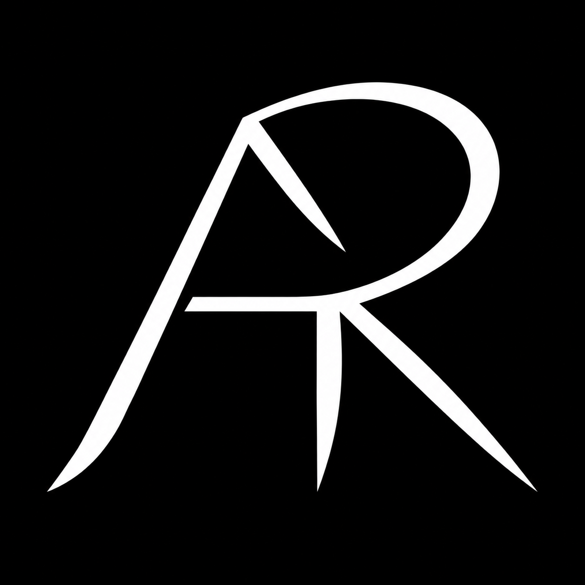

 

  

<h1 align="center"><b>ARKium</b></h1>
<h4 align="center">The desktop sibling to ARKster — a local-first, offline reading companion for your own folder of novel text & markdown files. No accounts, no cloud sync, no Play Store or app store dependency.</h4>
<h4 align="center">
  <a href="/docs/foundational/what-is-arkium.md">What is ARKium?</a> |
  <a href="/docs">Documentation</a> |
  <a href="/docs/foundation">For Settled Decisions</a>
</h4>

## The ARK ecosystem

| App | Platform | Who it's for |
|---|---|---|
| [ARKster](https://github.com/Rae-ARK/ARKster) | Android | Anyone with a folder of novels |
| **ARKium** (this repo) | Desktop | Anyone with a folder of novels |
| [ARKarium](https://github.com/Rae-ARK/arkarium) | Android | Readers of Rae ARK's own novels |

ARKster and ARKium are general-purpose readers for your own files. ARKarium is a separate app for people who read Rae ARK's novels specifically; it handles delivering those novels to readers, and that distribution job stays ARKarium's, not ARKium's.

What *is* planned for ARKium is the other half of the relationship: desktop as the full library, phone as a curated offline subset — the iTunes-for-an-iPod role, for both Android siblings. Since ARKarium carries over ARKster's storage model and folder conventions, a backup/sync channel built for ARKster's library shape works for ARKarium's too, without ARKium needing to know which app put the files there. **This is a planned direction, not a current feature** — see [`docs/proposal/FUTURE_IDEAS.md`](docs/proposal/FUTURE_IDEAS.md#v2-lan-sync-itunes-for-novels) for the design sketch. See [`docs/foundation/ANDROID_REFERENCE.md`](docs/foundation/ANDROID_REFERENCE.md) for how the three compare today.

## Stack
- C (C11)
- [GTK 4](https://www.gtk.org/) + libadwaita — native Linux toolkit, no bundled web runtime
- SQLite for favorites and reading progress

## Status
🚧 MVP v0.01 — you can pick a library folder, browse novels and chapters, read, favorite, and resume where you left off. Previous SvelteKit/Capacitor and Neutralino.js/Vue attempts were scrapped in favor of a native GTK shell. See [`docs/foundation/ARCHITECTURE.md`](docs/foundation/ARCHITECTURE.md) for design details and [`docs/implementation/ROADMAP.md`](docs/implementation/ROADMAP.md) for what is built and what is next.

## Getting started
See [`docs/foundation/GETTING_STARTED.md`](docs/foundation/GETTING_STARTED.md).

## Docs
Docs are organized by lifecycle stage — see [`docs/INDEX.md`](docs/INDEX.md).

## License

ARKium is Free Software: You can use, study share and improve it at your
will. Specifically you can redistribute and/or modify it under the terms of the
[GNU General Public License](https://www.gnu.org/licenses/gpl.html) as
published by the Free Software Foundation, either version 3 of the License, or
(at your option) any later version.

More information can be found [here](https://github.com/Rae-ARK/ARKium/blob/main/LICENSE).
